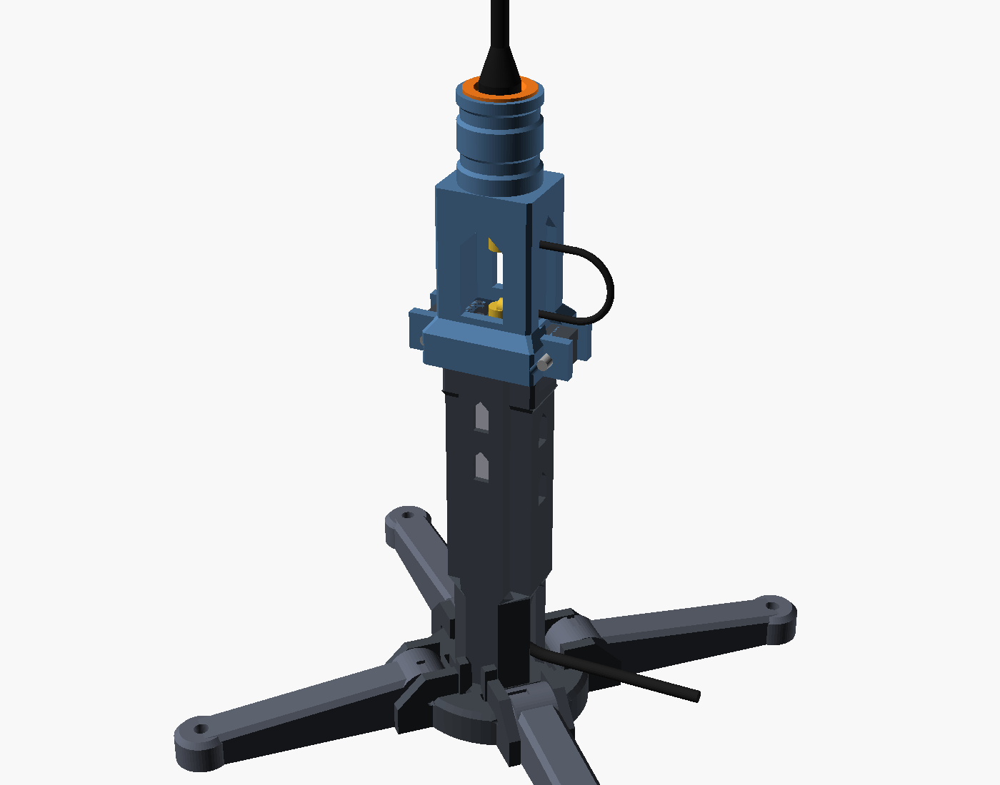
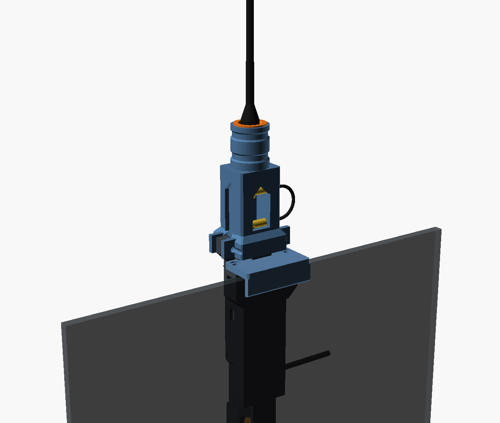
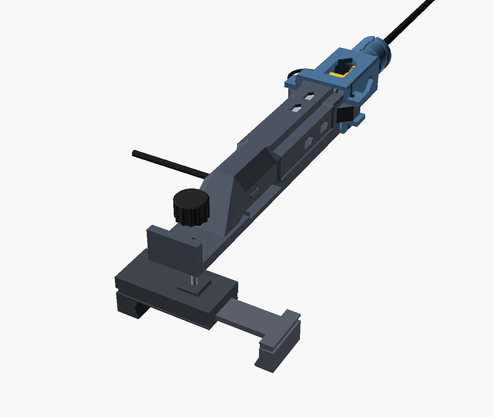
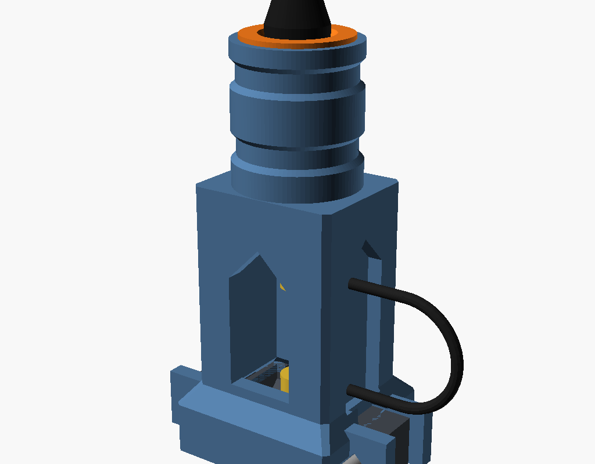

# SDRoost

**3D-printable RTL-SDR Blog V4 and Airspy Mini stands for ham radio and field SDR.**

A roost for your SDRs.

## What is SDRoost?

SDRoost is a small family of 3D-printed radio and antenna stands for the [RTL-SDR Blog V4](https://www.rtl-sdr.com/) and the [Airspy Mini](https://airspy.com/). One print of each model holds either radio. A bolt-on mast carries the whip — Nagoya NA-771, Diamond RH789, or Diamond SRH789 — so the radio's SMA jack never takes the load.

The Field Roost is a folding desktop and field base with locking legs and tent-stake holes. The Laptop Perch hooks over a normal laptop lid. The Phone Nest clips onto a phone in a case and can also sit on a tripod. All three share the same cross pocket and the same mast, and the STLs are parametric OpenSCAD, sized for everyday FDM printers (designed on a Creality K2 Pro) in PETG.

## Features

- **One pocket, two radios.** The same print holds an RTL-SDR Blog V4 or an Airspy Mini. No sleeve, no adapter print.
- **The mast takes the antenna load.** An SMA female–female bulkhead and a short right-angle RG316 jumper keep the whip's weight off the radio.
- **Shared parts.** The Field Roost, Laptop Perch, and Phone Nest all use the same cross pocket and mast mount, so the mast and inserts you print once fit all three.
- **Field-ready.** Locking folding legs and holes for tent pegs (≤ 5 mm) on the Field Roost.
- **Cable-first.** Plug the USB cable on first, then lower the radio in from the top. The cable runs down a 31 mm open bay with generous bend room.
- **Print-in-place.** No supports. PETG preferred for the rigid parts; TPU 95A for the grip inserts and mount pads.

## Compatible radios

**Radios** — no sleeve, no adapter print:

- **RTL-SDR Blog V4** (case 27 × 13 × 69 mm, SMA 9 mm, about 30 g) drops into the pocket one way and rests on ledges at its ends. USB-C.
- **Airspy Mini** (case 27 × 11 × 52 mm, SMA assumed 13 mm, about 21 g) drops in turned 90° and rests on its own ledges. Crush ribs hold it in the thinner axis. The Mini has a male USB-A plug, so it needs a USB-A extension or a 90° USB-A adapter.

Both radios end up with their SMA face at the same height, under the mast.

**Antennas**, via swap-in TPU grip inserts:

- Nagoya **NA-771** (insert bore sized from a measured 14.70 mm base)
- Diamond **RH789** (BNC; measured 14.53 mm plug sleeve)
- Diamond **SRH789** / slim SMA whip (estimated bore 11.4 mm)

## Variants

| Model | What it is | Print this |
|---|---|---|
| **Field Roost** | Folding desktop / field stand with locking legs and tent-stake holes | [`models/field-roost/rtlsdr_v4_3_universal_stand_print.stl`](models/field-roost/rtlsdr_v4_3_universal_stand_print.stl) |
| **Laptop Perch** | Hook that sits over a normal laptop lid (4–9 mm thick) | [`models/laptop-perch/`](models/laptop-perch/) (body, hook, TPU pads, knob) |
| **Phone Nest** | Spring-band clip for phones 60–90 mm wide in a case, with a 90° indexed rotor and a 1/4-20 tripod nut | [`models/phone-nest/`](models/phone-nest/) (body, slider, rotor, pads, knob) |
| **Mast + inserts** | Bolt-on antenna support, shared by every model | [`models/mast/antenna_mast.stl`](models/mast/antenna_mast.stl) plus one TPU insert |

## Print settings

Designed around a **Creality K2 Pro** with a 0.4 mm nozzle, but any FDM printer that can hold the footprint will do. Print every STL in the orientation it was exported. **No supports** anywhere.

| Setting | Value |
|---|---|
| Material | PETG preferred for rigid parts (PLA is fine indoors); TPU 95A for inserts and pads |
| Layer height | 0.2 mm |
| Walls | 4 |
| Infill | 30 % gyroid |
| Nozzle / bed, PETG | 240 °C / 80 °C |
| Supports | none |

The Field Roost print is 184 × 184 mm on the bed and 158 mm tall, about 167 g of PETG. A 5 mm brim is advised on the taller parts; do not let it weld a hinge or latch gap shut. Full orientation, brim, and gram estimates are in the **[print guide](docs/print-guide.md)**.

Print **`rtlsdr_v4_3_universal_stand_print.stl`** for the Field Roost, not the `_folded` file (that is a reference pose only).

## Bill of materials

Hardware is modest: a few M4 bolts and nuts, optional tent pegs for the Field Roost, and for the mast an SMA female–female bulkhead plus a 10 cm right-angle RG316 jumper. The Laptop Perch and Phone Nest also need printed TPU pads and a thumbscrew knob; the Phone Nest uses two #64 rubber bands and a 1/4-20 trap nut for a tripod.

Radios, antennas, and USB cables are not included. The full list, gram estimates, and cable notes (including Airspy Mini extension sizing) are in the **[parts list](docs/bom.md)**.

## Build instructions

1. Read the **[print guide](docs/print-guide.md)** for orientation, material and settings.
2. Print the model you want, plus the **mast** and the **insert** that matches your antenna.
3. Gather the hardware in the **[parts list](docs/bom.md)**.
4. Follow the **[assembly steps](docs/assembly.md)**.
5. After the Field Roost comes off the bed, flex each latch tab a few times and swing each leg until the hinges move freely.

A zip of the v1.0 STLs is on the [Releases](https://github.com/kamakauzy/sdroost/releases/tag/v1.0) page if you just want to print.

## Gallery

**Field Roost** — RTL-SDR Blog V4, Airspy Mini, folded for packing, and the open USB cable bay:

**Laptop Perch** — hooking over a laptop lid, from the front and the back:

**Phone Nest** — portrait, landscape, and the parts laid out:

**Mast and inserts** — the mast itself is unchanged from the earlier stand; the previews with a complete radio show that older, shorter column:

## FAQ

### How do I mount an RTL-SDR in the field?

Print the Field Roost (`rtlsdr_v4_3_universal_stand_print.stl`) plus the shared mast and the insert for your antenna. The stand has locking folding legs and Ø 5.5 mm pad holes for tent pegs (≤ 5 mm), which are recommended outdoors with a long whip. Plug the USB-C cable onto the RTL-SDR Blog V4 first, then lower the radio into the pocket from the top. The antenna sits on the bolt-on mast, so the radio's SMA jack never takes the load.

### Will the Airspy Mini fit?

Yes. One print of each model holds either an RTL-SDR Blog V4 or an Airspy Mini. The Mini (case 27 × 11 × 52 mm) drops into the same cross pocket turned 90°, and crush ribs hold it in the thinner axis. Because the Mini has a male USB-A plug, it needs a USB-A extension or a 90° USB-A adapter. The cable bay is sized for a full-size female extension end 12 × 20 × 40 mm; a short female end or a 90° adapter is the more comfortable fit if your extension is bulky.

### Do I need a different stand for each radio?

No. The Field Roost, Laptop Perch, and Phone Nest all use the same cross pocket. Print a model once and swap radios.

### What antennas are supported?

Swap-in TPU grip inserts are included for the Nagoya NA-771, the Diamond RH789 (BNC), and the Diamond SRH789 / slim SMA whip. The mast takes an SMA female–female bulkhead and a short right-angle RG316 jumper (10 cm is the nominal length; 8–15 cm works). A BNC or SMA barrel adapter is used when the antenna's connector needs it. See the [parts list](docs/bom.md) for the exact adapters.

### Can I clip this to a laptop or a phone?

Yes. The **Laptop Perch** hooks over a normal laptop lid 4–9 mm thick. The display lid must be at least about 182 mm tall, which is fine for most 13–16" laptops. The **Phone Nest** is a spring-band clip for phones 60–90 mm wide in a case, with a 90° indexed rotor and a 1/4-20 tripod nut in the fixed jaw.

### What printer and filament should I use?

Designed around a Creality K2 Pro with a 0.4 mm nozzle, but any FDM printer that can hold the footprint will do. PETG is preferred for the rigid parts (PLA is fine indoors). Print the grip inserts and the mount pads in TPU 95A when you can. No supports, 0.2 mm layers, 4 walls, 30 % gyroid. After print-in-place parts come off the bed, work the hinges and latches free by hand before you assemble anything.

### Where do I download the STLs?

From the model folders in this repository, or grab [`sdroost-v1.0-stls.zip`](https://github.com/kamakauzy/sdroost/releases/download/v1.0/sdroost-v1.0-stls.zip) from the [v1.0 release](https://github.com/kamakauzy/sdroost/releases/tag/v1.0).

## Docs

- [Print guide](docs/print-guide.md) — slicer settings, orientation, brim and post-print flex
- [Parts list (BOM)](docs/bom.md) — hardware, filament, and USB cable notes
- [Assembly](docs/assembly.md) — step-by-step, including how the leg latches work
- [Design notes](docs/design-notes.md) — cross pocket, cable-bend room, stability numbers, and assumptions
- [Radio / mast interface](models/field-roost/INTERFACE.md) — geometry for anyone deriving a new mount
- [Contributing / mesh gates](tools/CONTRIBUTING.md) — run these checks before you send a new STL

## License

- **Models, documentation and images:** [CC BY-SA 4.0](LICENSE)
- **Scripts in `tools/`:** [MIT](LICENSE)

SDRoost is an independent project and is not affiliated with RTL-SDR Blog, Airspy, Nagoya or Diamond.

## Source

Parametric OpenSCAD is in each model folder. The Field Roost is `models/field-roost/rtlsdr_v4_3_universal_stand.scad`. The Laptop Perch and Phone Nest share `rtlsdr_universal_variants.scad` (set `vpart` to the part you want). The mast and inserts come from `models/mast/rtlsdr_v4_1_rugged_antenna_mast.scad` with `part = "mast"` or `part = "insert"`. Do not print the stand from the mast file — that is the older column. Print the Field Roost instead.
