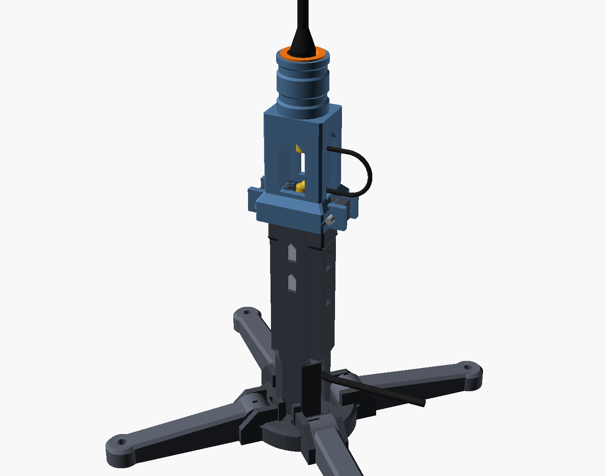
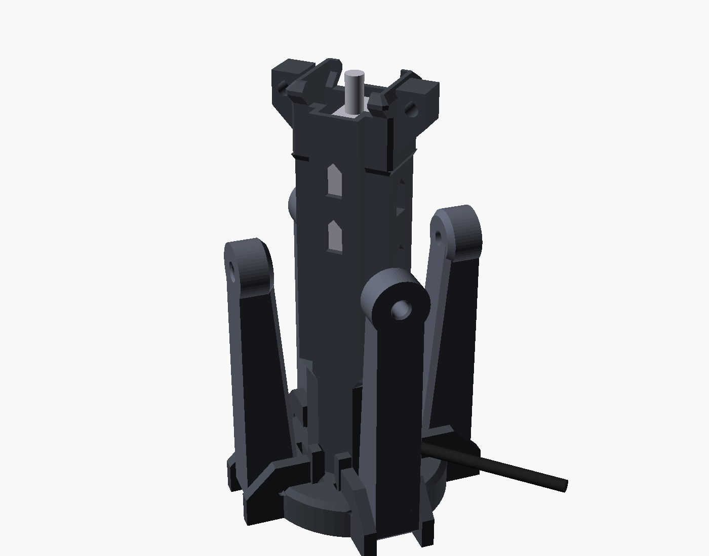
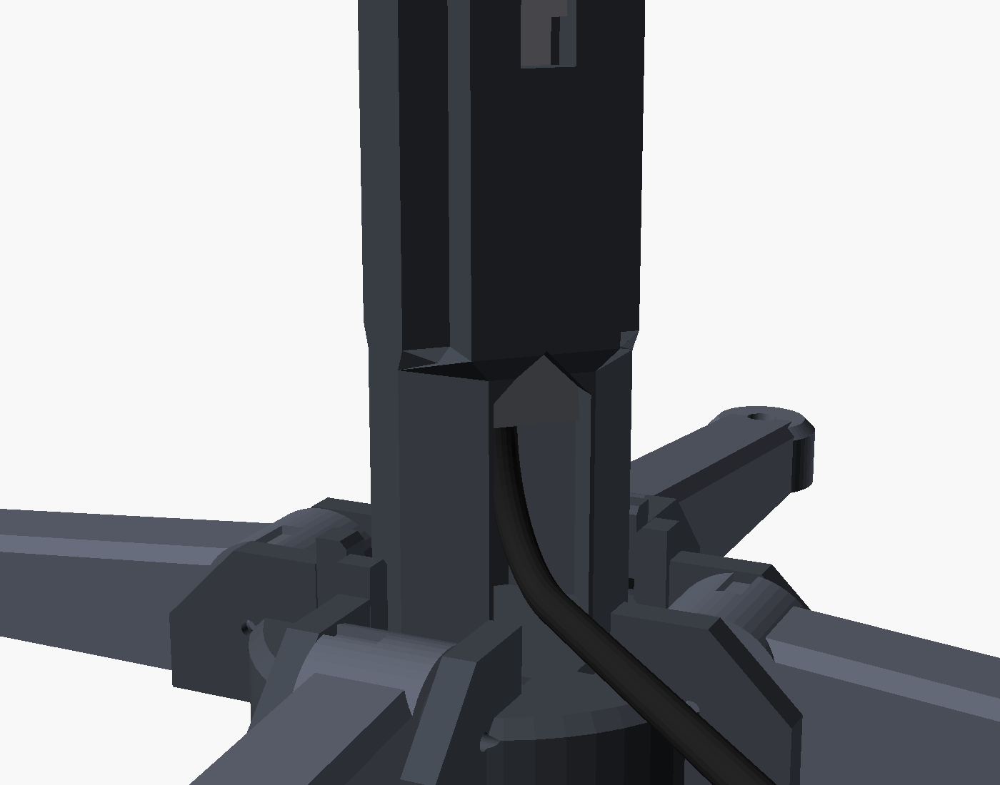
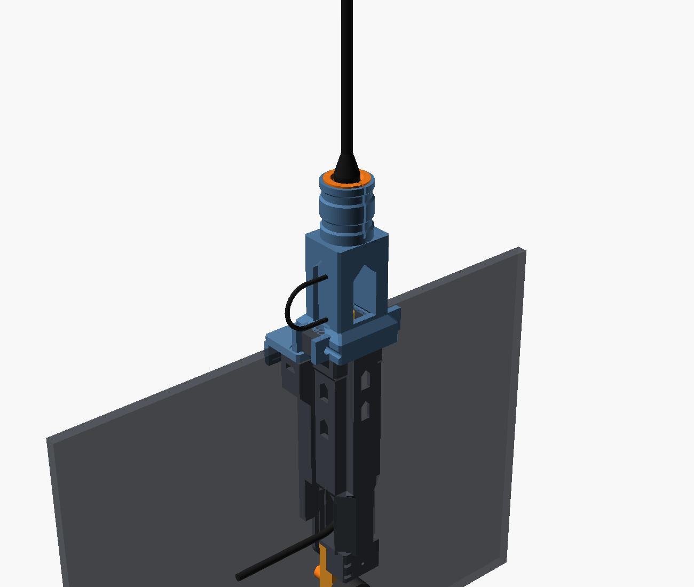
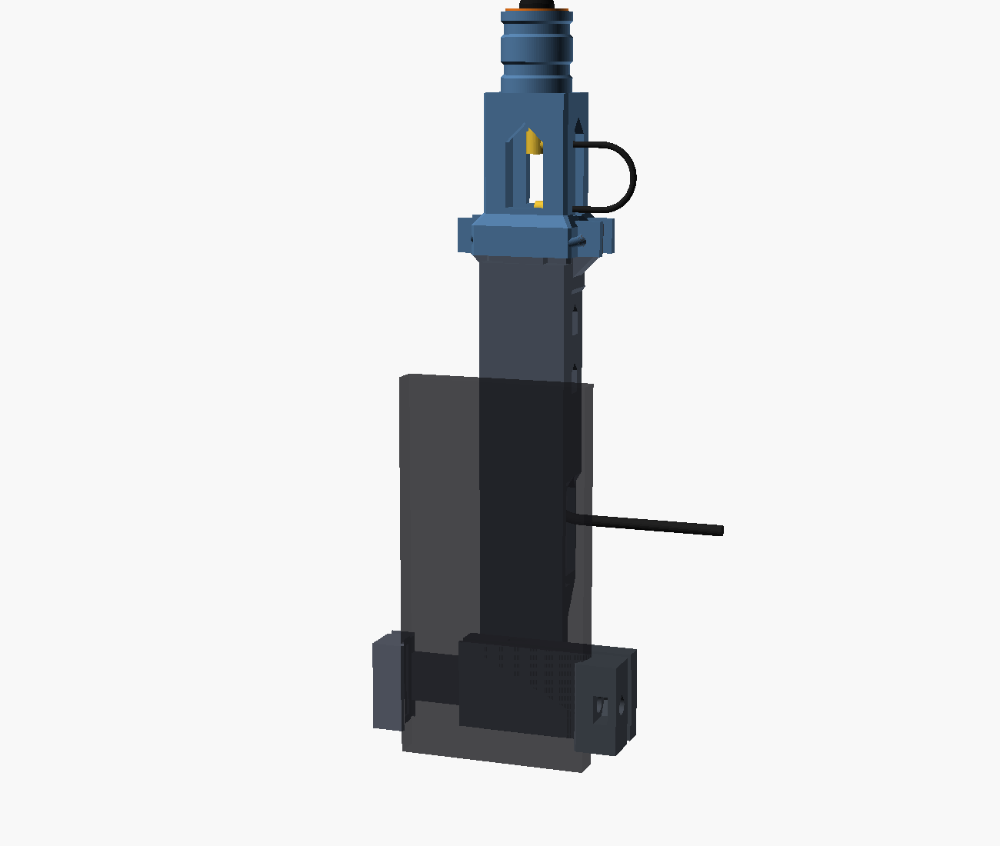
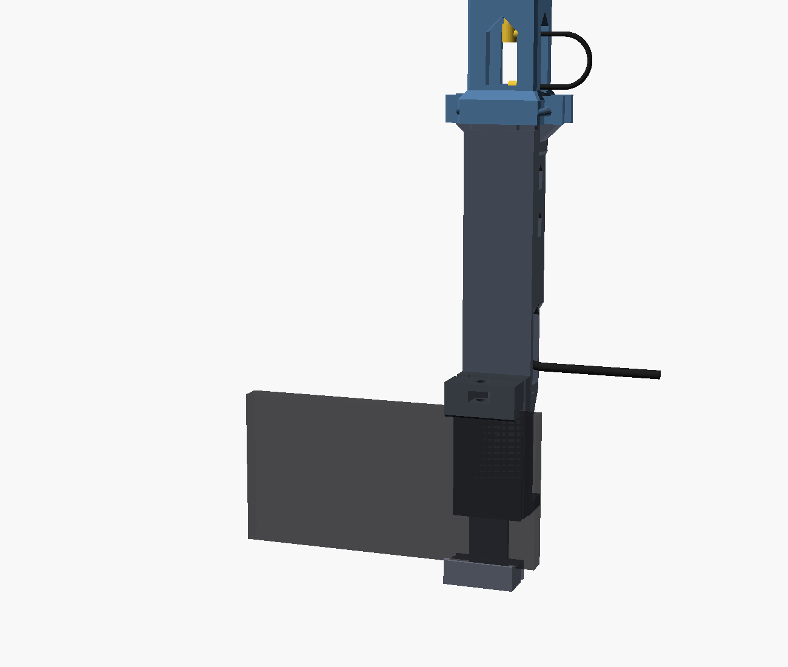
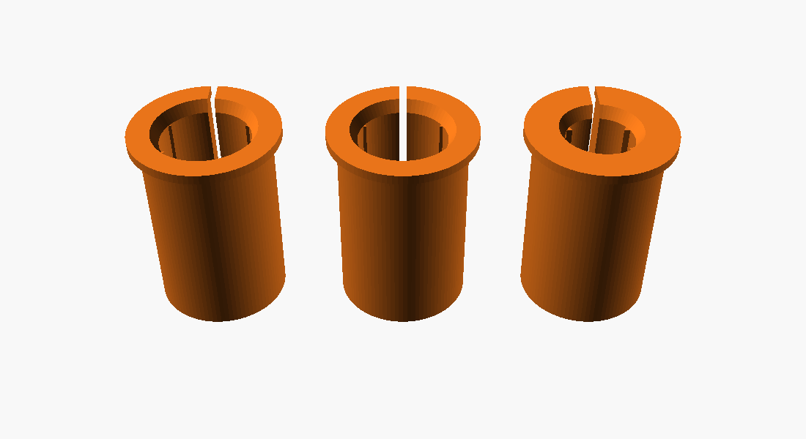

# SDRoost

**A roost for your SDRs.**

Folding field stand, laptop-screen perch, and phone nest for the [RTL-SDR Blog V4](https://www.rtl-sdr.com/) and the [Airspy Mini](https://airspy.com/). One print of each model holds either radio. Your antenna sits on a bolt-on mast, so the radio's SMA jack never takes the load.

## The flock

| Model | What it is | Print this |
|---|---|---|
| **Field Roost** | Folding desktop / field stand with locking legs and tent-stake holes | [`models/field-roost/rtlsdr_v4_3_universal_stand_print.stl`](models/field-roost/rtlsdr_v4_3_universal_stand_print.stl) |
| **Laptop Perch** | Hook that sits over a normal laptop lid (4–9 mm thick) | [`models/laptop-perch/`](models/laptop-perch/) (body, hook, TPU pads, knob) |
| **Phone Nest** | Spring-band clip for phones 60–90 mm wide in a case, with a 90° indexed rotor and a 1/4-20 tripod nut | [`models/phone-nest/`](models/phone-nest/) (body, slider, rotor, pads, knob) |
| **Mast + inserts** | Bolt-on antenna support, shared by every model | [`models/mast/antenna_mast.stl`](models/mast/antenna_mast.stl) plus one TPU insert |

The Field Roost, Laptop Perch and Phone Nest all use the same **cross pocket** and the same mast mount, so the mast and inserts you print once fit all three.

## Supported radios and antennas

**Radios** — no sleeve, no adapter print:

- **RTL-SDR Blog V4** (case 27 × 13 × 69 mm, SMA 9 mm) drops into the pocket one way and rests on ledges at its ends.
- **Airspy Mini** (case 27 × 11 × 52 mm, SMA assumed 13 mm) drops in turned 90° and rests on its own ledges. Crush ribs hold it in the thinner axis.

Both radios end up with their SMA face at the same height, under the mast. Plug the USB cable on first, then lower the radio in from the top. The cable runs down a 31 mm open bay and out the front.

**Antennas**, via swap-in grip inserts:

- Nagoya **NA-771** (insert bore sized from a measured 14.70 mm base)
- Diamond **RH789** (BNC; measured 14.53 mm plug sleeve)
- Diamond **SRH789** / slim SMA whip (estimated bore 11.4 mm)

The mast takes an SMA female–female bulkhead and a short right-angle RG316 jumper, so the antenna's weight goes through the mast, not the radio.

## Quick start

1. Read the **[print guide](docs/print-guide.md)** for orientation, material and settings (PETG preferred, no supports).
2. Print the model you want, plus the **mast** and the **insert** that matches your antenna.
3. Gather the hardware in the **[parts list](docs/bom.md)** (a few M4 bolts, and for the mast a bulkhead and a 10 cm jumper).
4. Follow the **[assembly steps](docs/assembly.md)**.
5. After the Field Roost comes off the bed, flex each latch tab a few times and swing each leg until the hinges move freely.

A zip of the v1.0 STLs is on the [Releases](https://github.com/kamakauzy/sdroost/releases) page if you just want to print.

## Gallery

**Field Roost** — RTL-SDR V4, Airspy Mini, folded, and the open cable bay:

**Laptop Perch** — over the lid, from the front and the back:

**Phone Nest** — portrait, landscape, and the parts laid out:

**Mast and inserts** — the mast itself is unchanged from the earlier stand; the previews with a complete radio show that older, shorter column:

## Docs

- [Print guide](docs/print-guide.md) — slicer settings, orientation, brim and post-print flex
- [Parts list (BOM)](docs/bom.md) — hardware, filament, and USB cable notes
- [Assembly](docs/assembly.md) — step-by-step, including how the leg latches work
- [Design notes](docs/design-notes.md) — cross pocket, cable-bend room, stability numbers, and assumptions
- [Radio / mast interface](models/field-roost/INTERFACE.md) — geometry for anyone deriving a new mount
- [Contributing / mesh gates](tools/CONTRIBUTING.md) — run these checks before you send a new STL

## License

- **Models, documentation and images:** [CC BY-SA 4.0](LICENSE)
- **Scripts in `tools/`:** [MIT](LICENSE)

SDRoost is an independent project and is not affiliated with RTL-SDR Blog, Airspy, Nagoya or Diamond.

## Source

Parametric OpenSCAD is in each model folder. The Field Roost is `models/field-roost/rtlsdr_v4_3_universal_stand.scad`. The Laptop Perch and Phone Nest share `rtlsdr_universal_variants.scad` (set `vpart` to the part you want). The mast and inserts come from `models/mast/rtlsdr_v4_1_rugged_antenna_mast.scad` with `part = "mast"` or `part = "insert"`. Do not print the stand from the mast file — that is the older column. Print the Field Roost instead.
